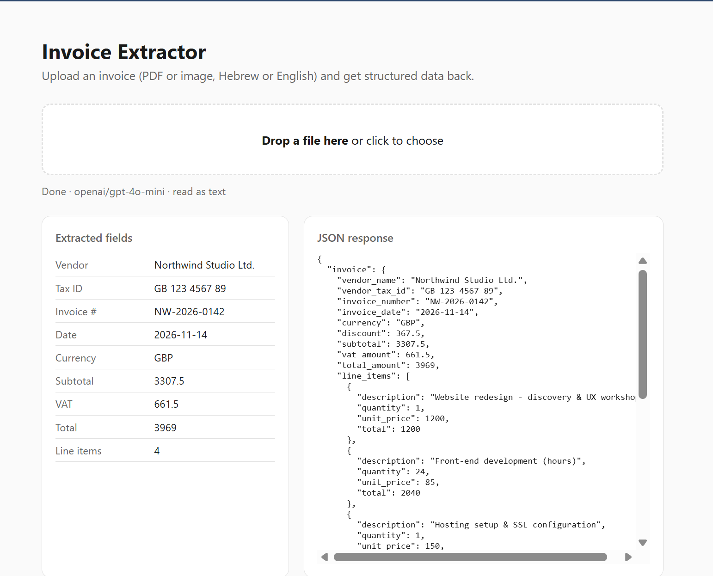
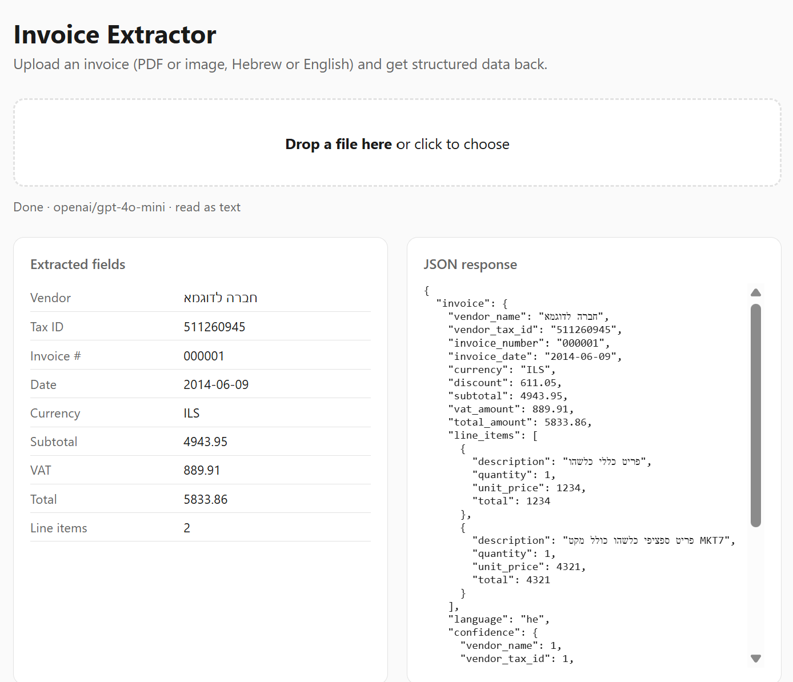
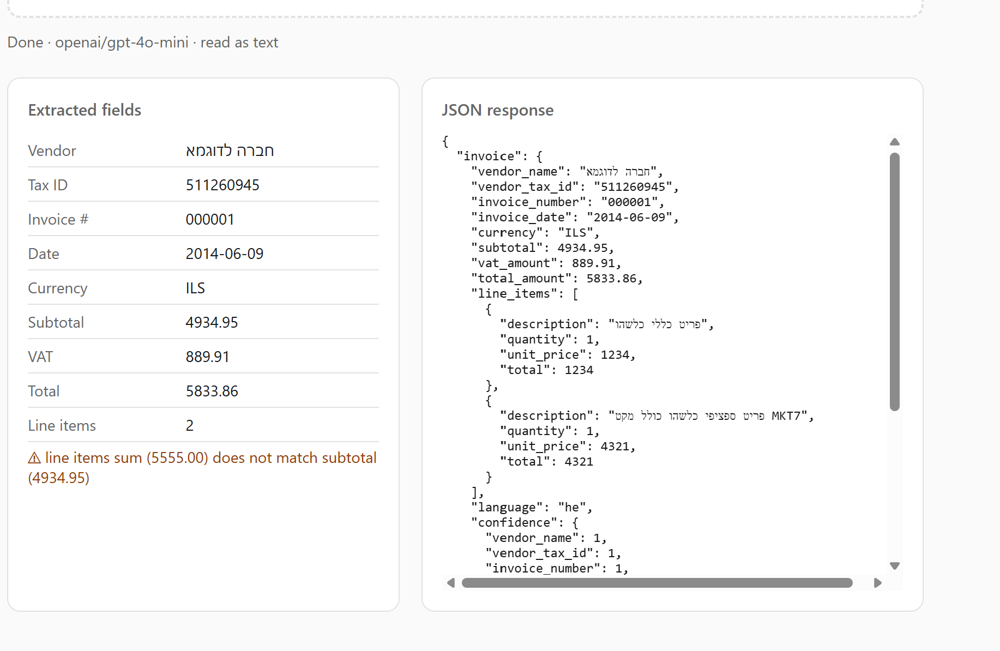
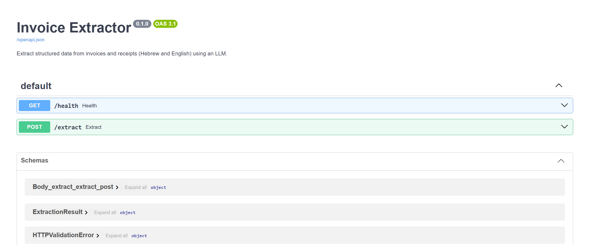

# Invoice Extractor

**Turn invoices and receipts into clean, structured JSON – in Hebrew or English – with one API call.**

Finance teams and bookkeepers still retype vendor names, dates and totals from PDFs into spreadsheets and accounting software. This service reads the document, extracts the key fields with an LLM, and checks the numbers before handing them back.

## Features

- **PDF and images** – PNG, JPG, WEBP, text PDFs and scanned PDFs (automatic fallback to vision when a PDF has no text layer)
- **Hebrew and English** – including ₪ / ש"ח → `ILS` normalization
- **Structured output** – vendor, tax ID, invoice number, date, currency, discount, subtotal, VAT, total and line items, validated with Pydantic
- **Built-in sanity checks** – flags when `subtotal + VAT ≠ total`, when line items minus discount don't match the subtotal, and when the model reports low confidence
- **Swap providers with one env var** – OpenAI, Anthropic (Claude) or a mock provider for demos and tests
- **Production basics** – Docker, upload size limits, clear error codes, 18 automated tests

## Screenshots

**English invoice → structured data.** Discount, VAT and totals all reconcile, date normalized to ISO, no warnings. (Try it yourself: [`samples/sample-invoice-en.pdf`](samples/sample-invoice-en.pdf).)



**Same API, Hebrew invoice.** Right-to-left text, ₪ amounts and Israeli VAT handled without any configuration.



**The model makes a mistake – validation catches it.** On an earlier run the model swapped two digits in the subtotal (4934.95 instead of 4943.95). The totals no longer reconciled, so the API returned a warning instead of silently passing bad numbers downstream.



**Interactive API docs** (Swagger, at `/docs`)



## Quick start

```bash
cp .env.example .env          # set LLM_PROVIDER and an API key (or keep "mock")
docker build -t invoice-extractor .
docker run --env-file .env -p 8000:8000 invoice-extractor
```

Then open:
- **http://localhost:8000** – upload page
- **http://localhost:8000/docs** – interactive API docs (Swagger)

### Without Docker

```bash
python -m venv .venv && source .venv/bin/activate
pip install -r requirements-dev.txt
export LLM_PROVIDER=mock      # or openai / anthropic with the matching API key
uvicorn app.main:app --reload
```

## API

### `POST /extract`

```bash
curl -F "file=@invoice.pdf" http://localhost:8000/extract
```

Response:

```json
{
  "invoice": {
    "vendor_name": "Example Ltd.",
    "vendor_tax_id": "515123456",
    "invoice_number": "INV-1001",
    "invoice_date": "2026-11-01",
    "currency": "ILS",
    "discount": null,
    "subtotal": 1000.0,
    "vat_amount": 180.0,
    "total_amount": 1180.0,
    "line_items": [
      { "description": "Consulting", "quantity": 1, "unit_price": 1000.0, "total": 1000.0 }
    ],
    "language": "en",
    "confidence": { "vendor_name": 0.98, "total_amount": 0.99 }
  },
  "provider": "anthropic",
  "model": "claude-haiku-5-5",
  "source": "text",
  "warnings": []
}
```

| Status | Meaning |
|---|---|
| 400 | Empty file |
| 413 | File larger than 10 MB |
| 415 | Unsupported file type or unreadable document |
| 502 | The model provider failed or returned invalid data |

### `GET /health`

Returns the active provider and model.

## How it works

```
upload ──► documents.py ──► text?  ──► extractors.py ──► validation.py ──► JSON
                      └──► no text ──► render page to PNG ──┘
```

1. **`documents.py`** – reads the PDF text layer with `pypdf`. If there's almost no text (a scan), renders the first page to an image with `pypdfium2`.
2. **`extractors.py`** – sends text or image to the selected provider with a strict JSON-only prompt, then validates the result into a Pydantic model.
3. **`validation.py`** – cross-checks totals, VAT and line items, and turns problems into human-readable warnings instead of silently returning bad numbers.

## Tests

```bash
pytest -q
```

To try a real extraction, upload [`samples/sample-invoice-en.pdf`](samples/sample-invoice-en.pdf) – a fictional invoice with a discount, 20% VAT and GBP totals.

Tests run against the mock provider, so they need no API key and no network.

## Configuration

| Variable | Default | Description |
|---|---|---|
| `LLM_PROVIDER` | `mock` | `mock`, `openai` or `anthropic` |
| `OPENAI_API_KEY` | – | Required for `openai` |
| `OPENAI_MODEL` | `gpt-4o-mini` | Any vision-capable OpenAI model |
| `ANTHROPIC_API_KEY` | – | Required for `anthropic` |
| `ANTHROPIC_MODEL` | `claude-haiku-5-5` | Any vision-capable Claude model |

## Roadmap

- Multi-page scanned PDFs
- Batch endpoint and async processing queue
- Export to Google Sheets / accounting software
- n8n workflow: email inbox → extraction → spreadsheet → Slack alert

## License

[MIT](LICENSE)
